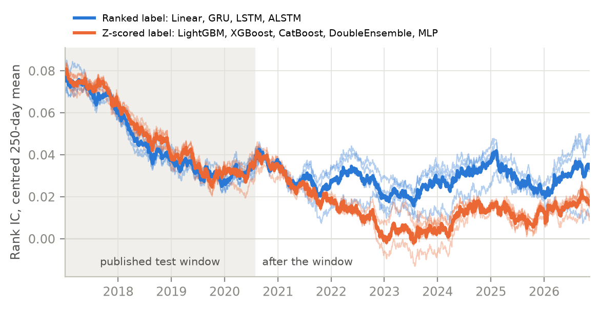
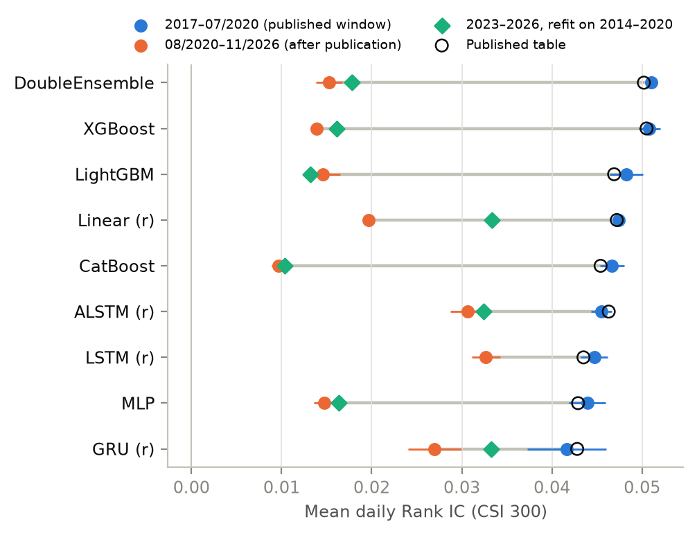

# What survives out of sample?

**A post-publication audit of the Qlib Alpha158 / CSI 300 stock-prediction benchmark on Chinese A-shares, 2017–2026.**

Microsoft's [Qlib](https://github.com/microsoft/qlib) benchmark table is a common yardstick for machine-learning models of Chinese stock returns. Every number on it was computed on one test window, January 2017 to July 2020. This repository re-runs the official configuration files of its models, unchanged except for the data source and the time segments, on independent daily data that include delisted stocks and run to 13 November 2026, and asks what the leaderboard says about the six years that followed.

The write-up is in [`paper/paper.pdf`](paper/paper.pdf).

## Findings

<!-- RESULTS -->
Rank IC is the mean over days of the cross-sectional Spearman correlation between the score and the return from the next close to the one after (Qlib's label); "Kept" is the post-2020 value as a share of the published-window value. Sorted by the post-2020 column.

| Model | Label | Published table | Ours, 2017–07/2020 | Ours, 08/2020–11/2026 | Kept | Refit, 2023–2026 |
|---|---|---:|---:|---:|---:|---:|
| LSTM | ranked | 0.0435 | 0.0447 | 0.0327 | 73% | – |
| ALSTM | ranked | 0.0463 | 0.0455 | 0.0307 | 67% | 0.0324 |
| GRU | ranked | 0.0428 | 0.0417 | 0.0270 | 65% | 0.0333 |
| Linear | ranked | 0.0472 | 0.0474 | 0.0196 | 41% | 0.0333 |
| DoubleEnsemble | z-score | 0.0502 | 0.0510 | 0.0153 | 30% | 0.0178 |
| MLP | z-score | 0.0429 | 0.0439 | 0.0147 | 34% | 0.0163 |
| LightGBM | z-score | 0.0469 | 0.0483 | 0.0146 | 30% | 0.0132 |
| XGBoost | z-score | 0.0505 | 0.0508 | 0.0139 | 27% | 0.0161 |
| CatBoost | z-score | 0.0454 | 0.0467 | 0.0097 | 21% | 0.0104 |

1. **The table reproduces.** On its own window, our mean Rank IC is within 0.0014 of the published value for every model, and the two rankings agree (Kendall τ = 0.83).
2. **Most of the signal is gone after July 2020.** The average Rank IC falls from 0.0467 to 0.0198 (-58%). Against a TopK strategy run on random scores, the average excess return falls from 16.8% to 6.4% a year. Refitting on 2014–2020 recovers only part of the loss.
3. **The ranking does not carry over.** Differences between models exceed seed noise in every window, yet the rank correlation between the two windows is τ = -0.33. The 90% model confidence set is {Linear, LightGBM, XGBoost, DoubleEnsemble, LSTM, ALSTM} in the published window, {LSTM, ALSTM} after it, and {Linear, GRU, ALSTM} on 2023–2026 with every model refitted.
4. **The label explains much of it.** Configs that train on a cross-sectionally ranked label kept 41–73% of their Rank IC; those that train on a z-scored label kept 21–34%. Changing only LightGBM's label from z-scores to ranks raises its post-2020 Rank IC from 0.0146 to 0.0286. This hypothesis was [written down](notes/prediction-2026-11-15.md) before the remaining runs finished; 4 of its 4 predictions held.
5. **The decay started before the benchmark window.** The Alpha158 features with a clear sign in 2008–2016 had already lost 56% of their Rank IC by 2017–2020, and lost another 50% after.





<!-- /RESULTS -->

## Reproduce

```bash
pip install -e ".[models,figures,dev]"        # Python 3.10–3.12 (pyqlib has no 3.13 wheels)
scripts/get_data.sh ~/data                      # 571 MB, checked against its SHA-256
export OOSAUDIT_QLIB_DIR=~/data/qlib_bin OOSAUDIT_CACHE=~/data/cache
PYTHONPATH=src python -m oosaudit.data          # Alpha158 features + label, CSI 300, 2008–2026

# one (model, protocol) cell; protocols: pub, refit, roll
PYTHONPATH=src python -m oosaudit.run lightgbm --protocol pub --seeds 0,1,2,3,4

export PYTHONPATH=src:experiments
python experiments/run_backtests.py --per-seed   # Qlib's TopK-Dropout backtest
python experiments/analyze_ic.py --refresh       # signal-level audit -> results/ic_audit.json
python experiments/analyze_backtests.py          # portfolio audit   -> results/backtest_audit.json
python experiments/analyze_features.py           # feature decay     -> results/feature_audit.json
python experiments/verify.py                     # recomputes the headline numbers independently
python experiments/make_figures.py && python experiments/make_numbers.py
cd paper && latexmk -pdf paper.tex
```

Every number in the paper is a macro generated by `experiments/make_numbers.py` from `results/*.json`; none is typed by hand. All runs used two CPU cores and 8 GB of memory.

## What differs from the official workflow

1. **Data.** The [`investment_data`](https://github.com/chenditc/investment_data) release of 14 November 2026 (6,176 listings, delisted stocks kept, dated CSI 300 membership), not the data Qlib collected for the published table.
2. **Test segment** extended from 1 August 2020 to 13 November 2026; the fitted models are identical.
3. **Seeds.** Five per tree model and MLP, three per recurrent model (the published table used twenty; its tree models were not seeded).
4. **CPU.** Thread counts capped at two; CatBoost's GPU-only Poisson bootstrap replaced by Bernoulli at the same rate.
5. **Memory.** Qlib's `CSZFillna` replaced by a vectorised version with identical output (tested), because the original needs more than 8 GB.
6. **PyTorch.** A shim lets Qlib's MLP pass the `verbose` argument that current PyTorch removed.

Configuration files are those of Qlib commit `54355232` (MIT licence, see `configs/qlib/LICENSE`).

## Layout

```
src/oosaudit/     data store, runner, metrics, tests of model sets, backtest, features
experiments/      analysis, figures, numbers for the paper, independent verification
configs/qlib/     official benchmark configs and table (Qlib, MIT)
results/          JSON summaries, daily ICs, feature ICs, daily excess returns
paper/            LaTeX source, figures and PDF
tests/            unit tests (pytest)
```

## Licence

MIT.
